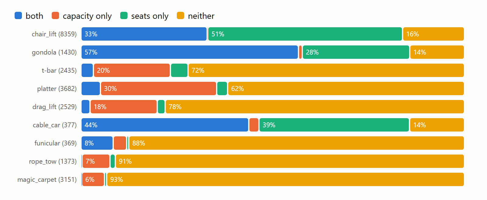
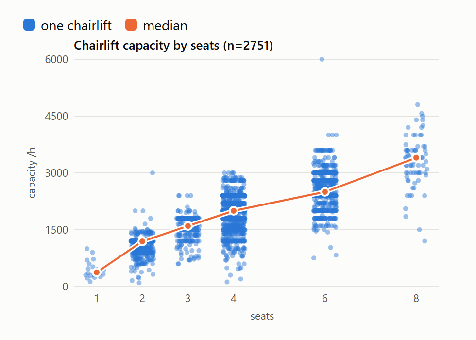
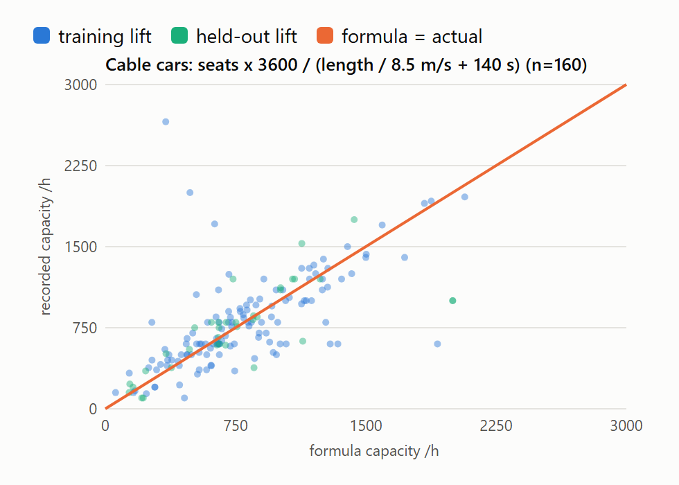
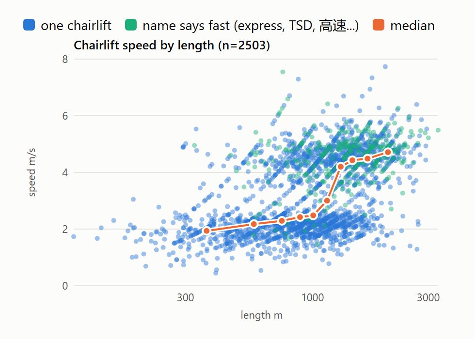

# 013. Fill missing lift capacity and speed from what else we know about a lift

**Status:** Proposed

**Code:** [busyness/lifts.py](../../busyness/lifts.py) (the estimates and name patterns) and [busyness/params.py](../../busyness/params.py) (the tables); [prototypes/lift_capacity.py](../../prototypes/lift_capacity.py) holds the analysis and hold-out tests, and regenerates the tables with `--params`

## Context

Busyness is modelled from lift capacity (004), and ride times set how long a lap takes (005). When a lift has no recorded capacity, or no recorded ride time, it currently gets a flat value for its type: 2,000 an hour and 2.5 m/s for every chairlift, for example. That treats an old two-seat fixed-grip chair and a new eight-seat detachable the same, although the second carries about three times as many people at twice the speed.

Many chairlifts, gondolas and cable cars have no recorded capacity, but do record their seats:

The green "seats only" segment is the opportunity: half of all chairlifts, 28% of gondolas and 39% of cable cars have seats but no capacity. Drag lifts, platters, T-bars, rope tows and magic carpets almost never record seats, and for them seats would say little anyway.

## Decision

Fill a missing capacity or ride time from the best evidence the lift has, falling back in this order:

1. **Recorded value**, within the plausible ranges of 004 (capacity 100–6,000 an hour, ride time 30–2,400 s).
2. **Seats**, recorded or, failing that, read from the lift's name (TSD6, Quad, 6er-SB, ペア...). Seats outside a plausible range for the type are treated as missing.
3. **Name:** a speed class read from the name (Express, TSD, KSB, 高速...), refining the seats.
4. **Type value:** today's flat value for the lift type.

Steps 2 and 3 apply to lifts with seats; how each type uses them:

| Lift type | Capacity | Speed |
|---|---|---|
| Chairlift | Lookup: seats × fast name | Lookup: seats × short or long (1,000 m) |
| Gondola, and cable cars with 10 seats or fewer | Lookup: seats | Flat (5 m/s) |
| Cable car with 11 or more seats | Formula, below | Flat (8 m/s) |
| Everything else | Flat | Flat |

A lookup cell with too few lifts behind it falls back to the type value. Length enters only through the chairlift speed lookup: vertical and the runs leaving a lift's top were tried and didn't help.

**Cable cars** shuttle two cabins back and forth, so their capacity follows from cabin size and length:

> capacity = cabin size × 3,600 ÷ (length ÷ 8.5 m/s + 140 s)

Here 8.5 m/s is the travel speed and 140 s the time spent loading and unloading at each end, both fitted to the data (see [Evidence](#cable-cars-a-formula-from-cabin-size-and-length)). Recorded ride times aren't used, since some seem to include loading and some don't. Lifts tagged as cable cars with 10 seats or fewer are treated as gondolas: their capacities (median 2,400 an hour) show they're mostly gondolas tagged wrongly.

**Tables are frozen** in `busyness/params.py`, generated by the prototype script from lifts in ski areas. A new OpenSkiMap download doesn't move them; they change only when someone regenerates them and checks the result.

**Each lift records where its capacity and speed came from** (recorded, seats, name or type), replacing today's yes/no `cap_known`, so results resting on weaker evidence can be discounted.

Steps 1 and 2 cover the "capacity" and "seats only" segments of the chart above. Names add little on top: of the lifts in the "neither" segment, a name gives seats or a speed class for 3% of all chairlifts (240), 11 gondolas and no cable cars. That leaves 13% of chairlifts, 13% of gondolas and 14% of cable cars on the type value. Ride time splits much the same way.

## Evidence

**Scope: lifts in a ski area.** The busyness model only fills lifts inside a ski domain, so the tables are built and tested on those alone: 24,159 of 31,032 operating lifts. The rest are mostly urban, tourist and industrial lifts, which would skew the tables: the London Cable Car (10-seat cabins, 4,080 an hour), city gondolas in Toulouse and Réunion, cliff railways, and EDF's service cableways at the Pyrenean dams. They make up 29% of all gondolas and 65% of all cable cars. Dropping them changes the gondola findings (below).

**Hold-out.** All errors are the median absolute error on **held-out** lifts, as a share of the recorded value. Except for gondolas (below), one ski area in five was set aside, with all its lifts (5,188 lifts), and every table or model was fitted on the rest. Splitting by ski area rather than by lift stops a resort's own mapping habits from leaking into the test. Errors for speed are given as the error in the ride time it produces (length ÷ speed), since that's what the model uses.

### Seats

For chairlifts, capacity rises steadily with seats:

A lookup by seats (and short or long, split at 1,000 m) against today's flat values:

| Chairlift seats | Held-out lifts | Capacity, today | Capacity, lookup | Ride time, today | Ride time, lookup |
|---|---|---|---|---|---|
| 2 | 71 | 90% | 16% | 22% | 15% |
| 3 | 44 | 36% | 15% | 15% | 11% |
| 4 | 258 | 17% | 17% | 61% | 14% |
| 6 | 160 | 26% | 17% | 89% | 8% |
| 8 | 18 | 38% | 13% | 92% | 7% |

Over all held-out chairlifts, the capacity error falls from 22% to 17%, and the ride-time error from 55% to 12%. Today's 2.5 m/s is 32% too slow for the median chairlift, so laps on fast chairs take about half as long again as they should.

Four-seaters gain nothing on capacity from seats alone: fixed-grip and detachable quads both centre on 2,000 an hour, with a wide spread between them.

### Gondolas: capacity from seats, speed flat

A gondola's capacity is its cabin size × 3,600 ÷ the gap between cabins, so capacity should rise with seats. It does, up to about 8 seats:

| Gondola cabin | Median capacity | Median speed |
|---|---|---|
| 4 seats | 900 an hour | 3.6 m/s |
| 6 seats | 1,800 | 4.2 m/s |
| 8 seats | 2,400 | 4.6 m/s |
| 10 seats | 2,400 | 5.0 m/s |
| 12–15 seats | 2,200–2,300 | 4.3–4.8 m/s |

Small cabins also mix two kinds of lift. Old, short ones, some of them pulsed (groups of cabins stopping together in the station), run at 1–2 m/s and carry about 500 an hour: village links such as Chalets in Les Trois Vallées, Lonzagne and Les Coches in Paradiski, and the Télécentre at Alpe d'Huez. Modern four- and six-seaters on long lines carry 1,300–2,400.

Gondolas are tested differently. Small cabins are scarce, and splitting by ski area risks putting a resort full of old gondolas wholly in the test or wholly in training. So gondolas are split at random **by lift** into five parts, each tested against a lookup built from the other four, repeated with ten different random splits. The figures below are the typical result; across the ten splits they moved by a few points at most, and splitting by ski area gave the same picture.

| Gondola cabin | Lifts | Capacity, flat 2,200 | Capacity, seats lookup | Ride time, flat 5 m/s | Ride time, seats lookup |
|---|---|---|---|---|---|
| 2–6 seats | 137 / 140 | 33% | **25%** | 17% | 15% |
| 8–10 seats | 600 / 514 | 21% | **18%** | **13%** | 14% |
| 12+ seats | 79 / 63 | 26% | **21%** | **17%** | 21% |

(Lifts: with recorded capacity / with recorded ride time.) A seats lookup helps capacity for every cabin size. For ride time, it helps small cabins a little and hurts large ones, so the flat speed stays. Before urban and tourist lifts were dropped, the lookup helped small cabins only: city gondolas with big cabins and low capacities had blurred the pattern.

Nothing found so far separates old small gondolas from modern ones:

- **Length:** adding it to the lookup, as short or long or as three bands, didn't help; nor did a fixed gap between cabins for each length band. Low-capacity four- and six-seaters turn up at every length.
- **Tags:** only 5 of 286 small gondolas record whether they're detachable.
- **Names:** words like *Luftseilbahn*, *ropeway* and *teleférico* looked like a sign of small shuttle cableways, but the lifts behind them are mostly ordinary gondolas, far above what the cable car formula gives. No name says *pulsée*.

Telemixes, which mix chairs and cabins on one line (Serre Thibaud at Montgenèvre, for example), are tagged as their own type and aren't part of these figures. Their median capacity (2,400 an hour) and speed (4.3 m/s) are close to today's flat values for them (2,200 and 5 m/s).

### Cable cars: a formula from cabin size and length

A lookup by cabin size helps (40% → 25%), but capacity depends just as much on length: a long cable car makes fewer round trips an hour. The formula in the [Decision](#decision) captures both. Fitted on the training areas' 125 cable cars with 11 or more seats, then tested on the 35 held out:

| Cable cars | Median error | 90th percentile |
|---|---|---|
| Today (flat 600 an hour) | 40% | 184% |
| Formula | **13%** | 100% |

The speed and loading time aren't sharply pinned down: 7 m/s with 100 s, or 9 m/s with 140 s, do about as well (13–14%). The largest misses above the line are lifts tagged as cable cars that really run many cabins, such as Funitel 3 Vallées (2,000 an hour recorded, 488 from the formula) and Funispace at Verbier. Funitels can be recognised by name and treated as gondolas. The misses below it, such as Transval at La Clusaz (100-seat cabins, 410 m: 600 recorded, 1,912 from the formula), look like wrong cabin sizes or capacities.

### Names

Names carry two kinds of hint:

- **Speed class.** 804 chairlifts have a name that says fast: express, xpress, high speed, TSD, KSB, kuppelbar, débrayable, 高速 (Japanese "high speed"), super chair, bubble. Only 41 say fixed: TSF, CLF, DSB.
- **Seats.** TSD4, 6er-SB, Quad, Triple, Double, and Japanese ペア and ロマンス (two-seaters), トリプル and クワッド. Seats read from names agree with the recorded seats for 1,211 of 1,223 chairlifts, and the 12 that disagree look like mapping errors.

Most European names in OpenStreetMap are just place names ("Seggiovia Florianca"), so codes are rare: TSD 61 and TSF 42 chairlifts, and no CLD, *ammorsamento* or *desembragable* at all. Japanese and North American names say the most.

A fast name is what separates detachable from fixed-grip quads:

| Four-seat chairlifts | Median speed | Median capacity |
|---|---|---|
| Name says fast | 4.6 m/s (206) | 2,400 an hour (165) |
| No hint | 2.5 m/s (895) | 2,000 an hour (1,129) |
| Name says fixed | 2.1 m/s (12) | 1,500 an hour (15) |

Adding the fast hint to the seats lookup brings the capacity error for held-out chairlifts from 17% to 15% (four-seaters 17% → 15%, fast-named chairlifts 17% → 8%). It adds nothing to speed, since length already picks out the fast chairs (below).

Names supply seats for 224 of the 1,363 chairlifts with none recorded, mostly in Japan.

### Length, vertical and runs

Length is a good guide to **speed**. Chairlifts fall into a slow band at about 2 m/s and a fast band at about 4.5–5 m/s (likely fixed-grip and detachable), and the fast band takes over from about 1,000 m. Fast-named lifts sit almost entirely in the fast band:

The diagonal streaks are ride times recorded in whole minutes.

Length, vertical and runs leaving the top are weak guides to **capacity**. Medians rise across them (chairlifts 1,800 → 2,400 an hour from the shortest quarter to the longest, 1,700 → 2,400 from two or fewer runs at the top to six or more), but a regression on them alone does worse than the type value (chairlifts 20% → 23–24%). With seats added, it reaches 14–15%, as good as or slightly better than the lookups. The exception is platters: length brings them from 20% to 15%.

### Type values

For drag-type lifts and magic carpets, today's flat values match the held-out medians closely (T-bar 18%, platter 20%, drag lift 20%), and capacity varies little. Keep them.

## Open questions and limits

- **Small gondolas:** the seats lookup still misses by about a quarter, because old village links and modern lifts share cabin sizes, and neither length, tags nor names separate them. Construction year might.
- **Speed from recorded capacity:** a lift with a recorded capacity but no ride time could take its speed class from its capacity (high capacity for its seats suggests detachable). This helped the regression, but most lifts missing a ride time miss capacity too.
- **Construction year:** OpenSkiMap doesn't export it. OpenStreetMap's `start_date` might separate old fixed-grip lifts from new detachables, but its coverage is unknown and it would need a separate download.

## Alternatives considered

- **Keep flat values by type (004).** Simple, but wrong by 50–90% on ride time for the chairlifts that carry most skiers, and by up to 90% on capacity at either end of the seat range.
- **Fit on every lift, ski area or not.** Urban and tourist lifts skew the tables: with them in, a seats lookup seemed to help only small gondolas.
- **Cable cars by cabin-size band.** Better than flat (25% against 40%), but blind to length; the formula does far better (13%).
- **Cable cars from recorded ride time.** Using the recorded ride time in the formula, where there is one, made it worse (19% against 13%), though the loading time wasn't refitted for that case.
- **A regression per type** on seats, length, vertical and runs. About as accurate as the lookups (chairlift capacity 14% against 15–17%), but far harder to explain and to keep in `params.py`, and unstable for thin types.
- **Tables fitted afresh on each pipeline run.** Always current, but every OpenSkiMap download would quietly move every domain's results.
- **One regression for all types.** Lift types differ too much: thin types get unstable coefficients (a magic carpet's vertical coefficient of −13.5, for example).

## Consequences

- **Test set skews to well-mapped lifts.** Almost every held-out chairlift with a recorded capacity also records seats (554 of 558), so the name and type steps are barely tested on the lifts that would actually use them.
- **More parameters:** a seats table per lift type, the cable car formula's two constants, and a list of name patterns that will need extending as new languages turn up.
- **Wrong seats propagate:** some seat values are clearly capacity typed into the seats tag (platters with 720 or 800 seats). Seats outside a plausible range per type are treated as missing.
- **Domains shift:** where chairlifts are mostly 2-seaters (older resorts, Japan) capacity falls; where they're 6- and 8-seat detachables it rises, and laps on fast chairs get shorter.
