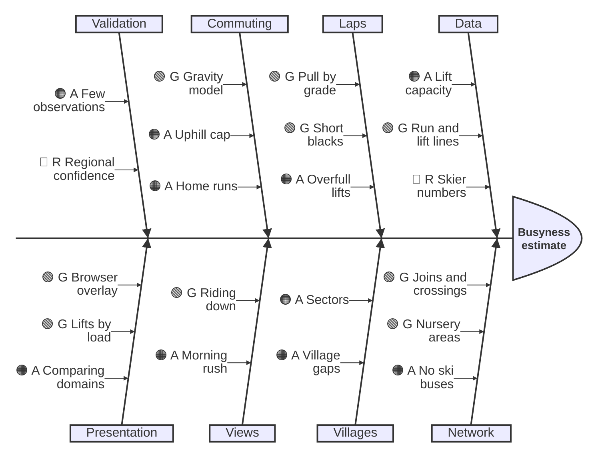

# Known issues

Open problems in the busyness model that affect its results. Each links to the decision record it concerns ([docs/decisions/](decisions/)). Ideas for later, fixes to make in the map data and the linked-domain issues are in [ideas-and-fixes.md](ideas-and-fixes.md). Observations from skiing that the model is checked against are in [observations.md](observations.md). Remove an item once it's fixed, and note the fix in the record.

## Busyness model (issue #3: `busyness/` and `busyness-engine/`)

Items keep their number as an ID (decision records and code refer to them as "known issue 11"), so the list below is grouped by theme, not numbered in order. GitHub issues are linked where an item has one.

### Priorities

The five things that move the model's results most, most important first.

| | Problem | Why it matters | Next step |
|---|---|---|---|
| 1 | **How many skiers a domain has** (8, [#5](https://github.com/AntonyM71/ski-altitude-explorer/issues/5), [#6](https://github.com/AntonyM71/ski-altitude-explorer/issues/6)) | Sets commuting volumes, both rushes and so every lift's load. Capacity ÷ 3.5 assumes about twice the skiers the model's own flows carry, and no domain can come out quiet. | Per-lift cycle times (Little's law) in place of 3.5 ([#6](https://github.com/AntonyM71/ski-altitude-explorer/issues/6)) |
| 2 | **Lifts don't limit the flow** ([#7](https://github.com/AntonyM71/ski-altitude-explorer/issues/7), [#8](https://github.com/AntonyM71/ski-altitude-explorer/issues/8)) | Commuters pass full lifts uncapped, and lapping skiers beyond capacity vanish, so the busiest lifts and everything past them are off. Likely behind Plein Sud (4). | An uphill cap that re-routes, like riding down |
| 3 | **No confidence flag by region** (9) | Every domain with 30 km and 5 lifts is published, however thin its data. | A per-domain flag to hide or caveat weak domains |
| 4 | **Sectors mix home areas and ski areas** (11) | Shapes every village's commuting share and every commuter's destination. | A modelling change that splits the two ideas |
| 5 | **No ski buses** (1) | Behind three of decision 011's open mismatches at Tignes–Val d'Isère (1, 2). | Valley buses as links between nearby villages |

### Status at a glance

🟢 G works and matches observations, 🟠 A works with known gaps, 🔴 R a known weakness that skews results. Update it when an item changes.

### Skier numbers and flows

- **8. Baseline loads rest on unsourced assumptions.** They set the model's normal level of traffic and should be rethought together. [004](decisions/004-busyness-from-lift-capacity.md), [006](decisions/006-laps-flow.md), [008](decisions/008-villages.md), [009](decisions/009-commuting.md)
  - **3.5 rides per skier per hour, and sizing skiers from a domain's own lifts:** see [#6](https://github.com/AntonyM71/ski-altitude-explorer/issues/6) and [#5](https://github.com/AntonyM71/ski-altitude-explorer/issues/5).
  - **The morning level.** Every village's lifts carry about 0.3× of their capacity from locals in the morning, so a village lift can only stand out through traffic passing through (Plein Sud, item 4). Option: scale the morning view so a typical village lift reads about 0.8×. That's a presentation choice, not new information.
  - **Lapping skiers wander without purpose.** Only commuters have a destination, and only in another sector. Nobody heads for a favourite area or a lunch spot within their own sector, and wanderers may over-gather at hubs, where big lifts pull hardest. Option: give more skiers destinations, using the commuting machinery.
  - **Other guesses:** the 60% top commuting share, the ability groups' shares and grade weights, the 1.5-hour rush, the 40% of laps already running during a rush, and the 60-minute travel-time decay. The decision records should say plainly that these are assumptions.
- **Lifts don't limit the flow:** commuters aren't capped going up an overfull lift ([#7](https://github.com/AntonyM71/ski-altitude-explorer/issues/7)), and lapping skiers beyond a lift's capacity are dropped, not queued or sent elsewhere ([#8](https://github.com/AntonyM71/ski-altitude-explorer/issues/8)).

### Data quality

- **9. Quality varies by region, with no confidence flag yet.** The production pipeline (012) runs every domain with at least 30 km of piste and 5 lifts, but the data behind it varies. North American bases are often not tagged as places (Overture's building footprints help with sizing, not with naming), and layouts differ in Japan and Scandinavia. Capacities are estimated where missing (013), but a domain where most are estimated is still rougher. A per-domain confidence flag (for example the share of lifts with recorded capacity, and whether villages came from places or the lift layout) would let the site hide or caveat weak domains. A North American domain such as Big Sky is worth checking first. [012](decisions/012-busyness-production-architecture.md)
- **7. Recorded capacities can be wrong, with no way to override them.** Serre Chevalier's "Serre Chevalier" cable car is recorded at 400 an hour and shows as 6× overloaded in the morning, now that its base station belongs to the Serre Ratier village. [004](decisions/004-busyness-from-lift-capacity.md), [013](decisions/013-fill-lift-capacity-and-speed.md)

### Villages and sectors

- **11. Sectors mix two ideas: home areas and ski areas.** Sectors come from how lifts exchange skiers (007), but the model uses them for two things:
  - **Home areas,** where people stay: they set a village's commuting share and where its locals start and end. Le Fornet is part of Val d'Isère: "nobody would bat an eyelid".
  - **Ski areas,** places people go skiing: they're commuters' destinations. La Daille, "in the middle" between Tignes and Val d'Isère, and Orelle are places in their own right. Today's sectors lose Orelle, putting its gondola base in Val Thorens's sector.

  Trials of alternatives (2026-10-30, four test domains):
  - **Network catchments** (each lift belongs to the village with the shortest round trip) capture home areas, but lose La Daille and Orelle. They also need riding down allowed on the way home, or valley villages such as Encamp, Canillo, Brides-les-Bains and Le Fornet end up with nothing.
  - **Merging villages you can ski between without a lift** gives Val Thorens with Les Menuires, all of Courchevel, and Méribel with Mottaret, matching how the owner names them. But it keeps Tignes apart from Val Claret, and Villeneuve apart from Le Bez.
  - **Merging villages within 15 minutes** fixes those two, but splits Val Thorens from Les Menuires.
  - **Communes** (from Overture's place hierarchy) match most examples, but are too coarse in places: Pas de la Casa is in Encamp parish, and La Plagne Tarentaise takes in almost all of La Plagne.
  - **OpenSkiMap sub-areas** capture ski areas, including Orelle, where they're mapped (Les Trois Vallées, Paradiski), but most domains have none.

  Next: a separate modelling change that splits the two ideas, combining these signals, with its own trial against the examples. The architecture keeps today's sectors behind a replaceable step, so this can change without touching the engine. [007](decisions/007-sectors-from-network.md), [008](decisions/008-villages.md), [009](decisions/009-commuting.md)
- **5. Villages: remaining gaps.** [008](decisions/008-villages.md)
  - **Sectors with no village still house skiers at a fallback station,** often a thoroughfare (Serre Chevalier's Yret, at 2,155 m, and TK Bez). Now that villages are sized by their own lifts, it isn't needed: a sector without a village is skied by people coming in. Remove it.
  - **Odd place names:** Overture's point for Courchevel isn't where Courchevel 1850 is, so 1850 appears as its quarters (La Choulière, Le Hameau, Brelin).

### Mismatches with observations

Open rows in decision 011's table, with the model's current numbers. [011](decisions/011-validate-with-observations.md)

- **1. No ski buses, so the Solaise back side skis home along the traverse** (Tignes–Val d'Isère). Observed: Piste M is busy at the end of the day, and skiers avoid flat runs like the Traversée du Laisinant. With no buses, Val d'Isère's locals on the Solaise side go home down Piste L and along the flat traverse, rather than back over Solaise and down Piste M; in reality many take the free bus from Le Laisinant. The traverse is 4th in the evening (about 1,810 an hour), Piste L 3rd, Piste M only 46th (about 710). The exact sectors make it worse: they merge Le Fornet's sector with the Solaise back side, so more of Val d'Isère's locals spend the day there and come home this way. Fix: add free valley ski buses as links between nearby villages (wait plus ride, say 10–15 minutes), for commuters and people going home. [005](decisions/005-busyness-network.md), [010](decisions/010-time-of-day-views.md)
- **2. Santons is quiet in the evening rush** (Santons haut 64th, Santons 70th), though observed to be a busy home run. It was 12th–22nd until riding down was added; most of Val d'Isère's evening traffic now goes home over Bellevarde's other runs or rides the Olympique down. Likely tied to item 1. [010](decisions/010-time-of-day-views.md)
- **3. Luc Alphand is busier than Briance on the way home to Chantemerle** (10th in the evening at 1,233 an hour; Briance 470, Ratier 664 riding down). Observed: people mostly ride Ratier down or ski Briance. Briance crosses Luc Alphand several times, so its longest black stretch without a way out is 466 m and it counts nearly like a red. Keeping the full end-of-day penalty helped only partly. Options: use the plain black weight for route choice on the way home, not just for the end-of-day penalty; or count a crossing as a way out only if the crossing run heads the same way, since Briance is a winding road you wouldn't choose halfway down a black. [006](decisions/006-laps-flow.md), [009](decisions/009-commuting.md)
- **4. Plein Sud isn't full in the morning** (0.66×, 36th of 127 lifts), though observed full, often with a queue. Partly the morning level (item 8), partly that Pionniers takes more of the commuters heading for the Funitel; an uphill cap ([#7](https://github.com/AntonyM71/ski-altitude-explorer/issues/7)) may change both.
- **15. Pista Llarga is the busiest run by day again** (Grandvalira, about 1,950 an hour; 3rd at about 1,400 before lift estimates). The six-seat detachables above it now carry 3,000 an hour from their seats, not the flat 2,000. The lift capacities are probably right; whether the run really is this busy needs an observation. [013](decisions/013-fill-lift-capacity-and-speed.md)
- **10. Unconfirmed against observations:**
  - **Ours against Sittelle** (Les Trois Vallées): the ranking is doubted.
  - **Tovière riding down** (about 1,910 an hour): people like riding it down, but this much is probably too many.
