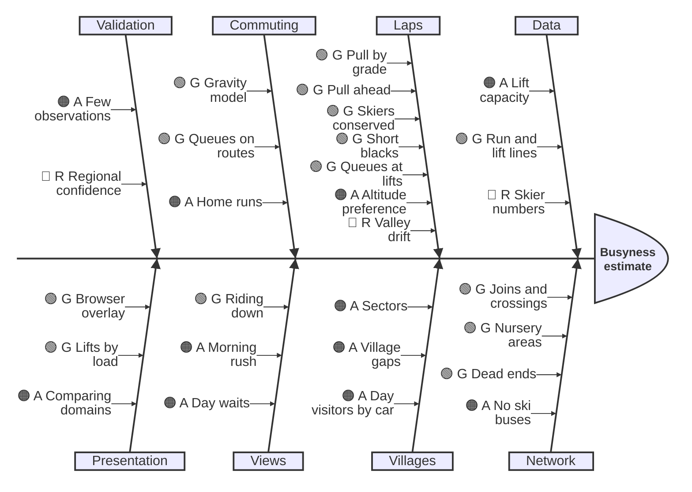

# Known issues

Open problems in the busyness model that affect its results. Each links to the decision record it concerns ([docs/decisions/](decisions/)). Ideas for later, fixes to make in the map data and the linked-domain issues are in [ideas-and-fixes.md](ideas-and-fixes.md). Observations from skiing that the model is checked against are in [observations.md](observations.md). Remove an item once it's fixed, and note the fix in the record.

## Busyness model (issue #3: `busyness/` and `busyness-engine/`)

Items keep their number as an ID (decision records and code refer to them as "known issue 11"), so the list below is grouped by theme, not numbered in order. GitHub issues are linked where an item has one.

### Priorities

The five things that move the model's results most, most important first.

| | Problem | Why it matters | Next step |
|---|---|---|---|
| 1 | **How many skiers a domain has** (8, [#5](https://github.com/AntonyM71/ski-altitude-explorer/issues/5), [#6](https://github.com/AntonyM71/ski-altitude-explorer/issues/6)) | Sets every lift's load. Since skiers are conserved in the simulated day ([017](decisions/017-day-simulation.md)), capacity ÷ 3.5 is visibly too many: 28–42% of skiers are queuing at noon, valley lifts with no way round collect the excess (Daille 209 minutes, Aravet 171), and a quarter to a third aren't home by 16:30. | Per-lift cycle times (Little's law) in place of 3.5 ([#6](https://github.com/AntonyM71/ski-altitude-explorer/issues/6)); published bed counts as the reference ([016](decisions/016-resort-populations.md)) |
| 2 | **Where lapping skiers go** (18) | Lapping skiers still drift down to valley lifts with no way round. The glaciers now fill (017), but how much of the drift is the population is untested. | Recheck once the population is sourced |
| 3 | **No confidence flag by region** (9) | Every domain with 30 km and 5 lifts is published, however thin its data. | A per-domain flag to hide or caveat weak domains |
| 4 | **Sectors mix home areas and ski areas** (11) | Shapes every village's commuting share and every commuter's destination. | A modelling change that splits the two ideas |
| 5 | **No ski buses** (1) | Behind three of decision 011's open mismatches at Tignes–Val d'Isère (1, 2). | Valley buses as links between nearby villages |

### Status at a glance

🟢 G works and matches observations, 🟠 A works with known gaps, 🔴 R a known weakness that skews results. Update it when an item changes.

### Skier numbers and flows

- **8. Baseline loads rest on unsourced assumptions.** They set the model's normal level of traffic and should be rethought together. [004](decisions/004-busyness-from-lift-capacity.md), [006](decisions/006-laps-flow.md), [008](decisions/008-villages.md), [009](decisions/009-commuting.md)
  - **3.5 rides per skier per hour, and sizing skiers from a domain's own lifts:** see [#6](https://github.com/AntonyM71/ski-altitude-explorer/issues/6) and [#5](https://github.com/AntonyM71/ski-altitude-explorer/issues/5).
  - **The morning level.** Every village's lifts carry about 0.3× of their capacity from locals in the morning, so a village lift can only stand out through traffic passing through (Plein Sud, item 4). Option: scale the morning view so a typical village lift reads about 0.8×. That's a presentation choice, not new information.
  - **Lapping skiers wander without purpose.** Only commuters have a destination, and only in another sector. Nobody heads for a favourite area or a lunch spot within their own sector, and wanderers may over-gather at hubs, where big lifts pull hardest. Option: give more skiers destinations, using the commuting machinery.
  - **Other guesses:** the 60% top commuting share, the ability groups' shares and grade weights, the 60-minute travel-time decay, the lift-to-run exchange rate (`LIFT_PULL` = 800, which now only matters against runs leading to no lift), from lift queues (015): the 10-minute queue tolerance (`QUEUE_TOLERANCE_MIN`) and the 5-minute band edge, the fair-weather altitude preference (`ALT_RATIO` = 2, 006), and from the simulated day (017): the 09:00–10:00 departures, the 15:00 home time, the view windows, nursery areas at 0.05 of the pull (`NURSERY_PULL`) and backup walks within 1 km (`DEAD_END_WALK_M`). The decision records should say plainly that these are assumptions.
- **18. Skiers favour some areas: valley lifts are quiet by day.** Lapping skiers spread downhill by pull alone, so many end up at valley-bottom lifts. In reality, by day people head for the higher areas with better snow, and valley lifts sit fairly empty: Aravet at Serre Chevalier, where you can usually get a cabin to yourself, and Daille at Val d'Isère. They're busy only at the start and end of the day. In the lift-queues trials, the valley lifts (Daille, the Funival, Aravet, Pré Chabert) were where queues grew without limit, because everyone skiing down ended up there with no other way on. The same pattern shows at Le Fornet: in reality skiers stay in the big bowls above, but the model gives the Glacier and Datcha chairs 80–90-minute queues (item 22). Options:
  - a preference for altitude or snow conditions in the lap pull (see the snow-conditions idea in [ideas-and-fixes.md](ideas-and-fixes.md));
  - skiers who lap within a favoured area rather than drifting down;
  - fewer laps ending at valley lifts by day, with the rushes left as they are.

  **Since the altitude preference** ([006](decisions/006-laps-flow.md)): lapping skiers now favour lifts whose bottoms sit higher in the domain, and runs leading to them. Its effect is small so far: run traffic by altitude barely moves, because every lift's top still releases its full capacity. It needs conservation (#6, item 17) to work properly.

  **Since day waits are measured against capacity** (2026-11-03, [015](decisions/015-lift-queues.md)): the runaway valley queues went. The drift itself remained.

  **Since the simulated day** ([017](decisions/017-day-simulation.md)): skiers are conserved, so the glaciers fill (Grande Motte 0.98× by day, Glacier and Datcha without queues). But Daille and Aravet run at capacity by day with long queues again (209 and 171 minutes): with capacity ÷ 3.5 skiers on the hill, the excess collects at valley lifts with no way round. Recheck once the population is sourced (item 8, [016](decisions/016-resort-populations.md)).

  Related to item 8 ("lapping skiers wander without purpose") and item 17. [006](decisions/006-laps-flow.md), [010](decisions/010-time-of-day-views.md)
- **23. No day visitors arriving by car.** Every skier starts from a village inside the domain. Some domains draw many skiers who drive in for the day and park at the lifts. At Grandvalira, Pas de la Casa and Grau Roig have big car parks filled from Andorra la Vella, Escaldes, Spain and France, and the modelled skiers are about twice the registered beds in Canillo and Encamp parishes ([016](decisions/016-resort-populations.md)). Serre Chevalier has the opposite case: Briançon is a real town, and many of its beds are residents' homes, not visitors'. Option: car parks (`amenity=parking` near lift bases) as starting points, sized by their spaces, with their own share of the domain's skiers. [008](decisions/008-villages.md), [009](decisions/009-commuting.md)
- **17. No time off the hill: restaurants, toilets and lunch.** Every skier is always riding, skiing or queuing. Real skiers stop for lunch, coffee and toilets, which takes them off the lifts for a good part of the day, and draws them to particular places (a mountain restaurant, a village at lunchtime). It matters for how many skiers the lifts actually carry (#6 needs a share of the day spent skiing). Restaurants are mapped in OpenStreetMap (`amenity=restaurant` near pistes), so they could become destinations and stops. Conservation no longer waits on it: the simulated day ([017](decisions/017-day-simulation.md)) bounds how far any group of lifts can fill. The project owner's view: breaks average out over the day, apart perhaps from lunch, so they can be part of the share on the hill at once (016). Pinned for later. [004](decisions/004-busyness-from-lift-capacity.md), [006](decisions/006-laps-flow.md)

### Data quality

- **9. Quality varies by region, with no confidence flag yet.** The production pipeline (012) runs every domain with at least 30 km of piste and 5 lifts, but the data behind it varies. North American bases are often not tagged as places (Overture's building footprints help with sizing, not with naming), and layouts differ in Japan and Scandinavia. Capacities are estimated where missing (013), but a domain where most are estimated is still rougher. A per-domain confidence flag (for example the share of lifts with recorded capacity, and whether villages came from places or the lift layout) would let the site hide or caveat weak domains. A North American domain such as Big Sky is worth checking first. [012](decisions/012-busyness-production-architecture.md)
- **19. Aravet and Casse du Bœuf aren't linked** (Serre Chevalier). Their bottom stations are 400 m apart and almost level (6 m), and skiers do go from one to the other, but nothing joins them in the network: no run, and 400 m is beyond the 250 m walk limit (`LIFT_WALK_M`). So skiers reaching Aravet's bottom can only take the Aravet eggs (900 an hour, still the old 4-seat Poma gondola) or the Mickey drag. In the lift-queues trials, Aravet's day queue grew without limit. Check OpenStreetMap for a missing track or run along the bottom first. If there's none, consider a longer walk limit on level ground, judged on the test domains' other pairs, not on this one example. [005](decisions/005-busyness-network.md)
- **16. The Funival's data at La Daille** (Tignes–Val d'Isère). The walk between the Daille gondola and the Funival is now in the network (lift-bottom walks, [005](decisions/005-busyness-network.md)). Still open: the Funival is mapped in two pieces (with a break at 1,930 m), and its capacity is the flat 1,500 an hour for a funicular, probably well under the real figure. Check it in OpenStreetMap. [013](decisions/013-fill-lift-capacity-and-speed.md)
- **7. Recorded capacities can be wrong, with no way to override them.** Serre Chevalier's "Serre Chevalier" cable car is recorded at 400 an hour and shows as 6× overloaded in the morning, now that its base station belongs to the Serre Ratier village. [004](decisions/004-busyness-from-lift-capacity.md), [013](decisions/013-fill-lift-capacity-and-speed.md)

### Villages and sectors

- **11. Sectors mix two ideas: home areas and ski areas.** Sectors come from how lifts exchange skiers (007), but the model uses them for two things:
  - **Home areas,** where people stay: they set a village's commuting share and where its locals start and end. Le Fornet is part of Val d'Isère: "nobody would bat an eyelid".
  - **Ski areas,** places people go skiing: they're commuters' destinations. La Daille, "in the middle" between Tignes and Val d'Isère, and Orelle are places in their own right. Today's sectors lose Orelle, putting its gondola base in Val Thorens's sector.

  Trials of alternatives (2026-10-30, four test domains):
  - **Network catchments** (each lift belongs to the village with the shortest round trip) capture home areas, but lose La Daille and Orelle. They also need riding down allowed on the way home, or valley villages such as Encamp, Canillo, Brides-les-Bains and Le Fornet end up with nothing.
  - **Merging villages you can ski between without a lift** gives Val Thorens with Les Menuires, all of Courchevel, and Méribel with Mottaret, matching how the owner names them. But it keeps Tignes apart from Val Claret, and Villeneuve apart from Le Bez.
  - **Merging villages within 15 minutes** fixes those two, but splits Val Thorens from Les Menuires.
  - **Communes** (from Overture's place hierarchy) match most examples, but are too coarse in places: Pas de la Casa is in Encamp parish, and La Plagne Tarentaise takes in almost all of La Plagne.
  - **OpenSkiMap sub-areas** capture ski areas, including Orelle, where they're mapped (Les Trois Vallées, Paradiski), but most domains have none.

  Next: a separate modelling change that splits the two ideas, combining these signals, with its own trial against the examples. The architecture keeps today's sectors behind a replaceable step, so this can change without touching the engine. [007](decisions/007-sectors-from-network.md), [008](decisions/008-villages.md), [009](decisions/009-commuting.md)
- **27. Small villages with a big sector send many commuters through out-of-the-way lifts.** Dou des Lanches (Les Trois Vallées), in a quiet corner above La Tania, queues 20 minutes in the morning and 38 in the evening. Tested by switching villages off: its morning commuters (2,950 an hour) all come from Courchevel's villages, most from Le Praz (650), La Tania (610) and La Perrière (550). Le Praz and La Tania are sized by their lift capacity at 2,842 and 1,844 skiers, large for small villages ([016](decisions/016-resort-populations.md)), and their sector, which also covers 1850, sends 46% of them to other valleys each morning, by the quickest way out of Courchevel's west end. Its evening load is Méribel's (about 2,200) and Belleville's (about 2,000) skiers going home. Should ease with village shares from beds or buildings (016) and with splitting home areas from ski areas (item 11). [008](decisions/008-villages.md), [009](decisions/009-commuting.md)
- **5. Villages: remaining gaps.** [008](decisions/008-villages.md)
  - **Sectors with no village still house skiers at a fallback station,** often a thoroughfare (Serre Chevalier's Yret, at 2,155 m, and TK Bez). Now that villages are sized by their own lifts, it isn't needed: a sector without a village is skied by people coming in. Remove it.
  - **Odd place names:** Overture's point for Courchevel isn't where Courchevel 1850 is, so 1850 appears as its quarters (La Choulière, Le Hameau, Brelin).

### Mismatches with observations

Open rows in decision 011's table, with the model's current numbers. [011](decisions/011-validate-with-observations.md)

- **1. No ski buses, so the Solaise back side skis home along the traverse** (Tignes–Val d'Isère). Observed: Piste M is busy at the end of the day, and skiers avoid flat runs like the Traversée du Laisinant. With no buses, Val d'Isère's locals on the Solaise side go home down Piste L and along the flat traverse, rather than back over Solaise and down Piste M; in reality many take the free bus from Le Laisinant. The traverse is 5th in the evening (about 2,060 an hour), Piste M only 48th (about 830). By day it's avoided (63rd); it rose to 11th while day waits were measured against releases (015), as skiers on the Le Fornet side steered away from the Glacier and Datcha chairs' runaway queues. The sectors have shifted it more than once: the exact sectors merged Le Fornet's sector with the Solaise back side, and since lift-bottom walks Le Fornet forms its own sector with Cascade and Céma, with Piste M quieter still. Fix: add free valley ski buses as links between nearby villages (wait plus ride, say 10–15 minutes), for commuters and people going home. [005](decisions/005-busyness-network.md), [010](decisions/010-time-of-day-views.md)
- **2. Santons is quiet in the evening rush** (Santons haut 41st, Santons 51st), though observed to be a busy home run. It was 12th–22nd until riding down was added; most of Val d'Isère's evening traffic now goes home over Bellevarde's other runs or rides the Olympique down. Likely tied to item 1. [010](decisions/010-time-of-day-views.md)
- **3. Luc Alphand is busier than Briance on the way home to Chantemerle** (9th in the evening at 1,401 an hour; Briance 686, Ratier 678 riding down). Observed: people mostly ride Ratier down or ski Briance. Briance crosses Luc Alphand several times, so its longest black stretch without a way out is 466 m and it counts nearly like a red. Keeping the full end-of-day penalty helped only partly. Options: use the plain black weight for route choice on the way home, not just for the end-of-day penalty; or count a crossing as a way out only if the crossing run heads the same way, since Briance is a winding road you wouldn't choose halfway down a black. [006](decisions/006-laps-flow.md), [009](decisions/009-commuting.md)
- **4. Plein Sud isn't full in the morning** (0.76×, 35th of 127 lifts; 0.64× before lift queues), though observed full, often with a queue. Partly the morning level (item 8), partly that Pionniers takes more of the commuters heading for the Funitel.
- **15. Pista Llarga is busy by day** (Grandvalira, 1st at about 2,140 an hour since the nursery ways through reopened, 2nd at 1,630 before; 1st at 2,030 before lift queues, 10th while day waits were measured against releases, and 3rd at about 1,400 before lift estimates). The six-seat detachables above it now carry 3,000 an hour from their seats, not the flat 2,000. The lift capacities are probably right; whether the run really is this busy needs an observation. [013](decisions/013-fill-lift-capacity-and-speed.md)
- **21. Cucumelle is short of full in the morning** (Serre Chevalier): 0.87× and 7th of 43 lifts (0.96× and 3rd before lift queues). It has an 11-minute day queue, so fewer laps are under way at the rush. Three other observations that regressed with lift queues (Lac de la Chambre, Edelweiss, Pelvoux) pass again since day waits are measured against capacity. The test is marked as a known failure (`todo`). [015](decisions/015-lift-queues.md)
- **22. Day queues that look wrong:** in the simulated day ([017](decisions/017-day-simulation.md)), Daille 209 minutes and Aravet 171 (items 18, 19), and long day queues at Grandvalira (Tarter about 50 minutes). Most likely the population (item 8): 28–42% of skiers are queuing at noon. Mont Blanc's queue went with the pull ahead (017), and Les Antenes's with the nursery fix (005). [015](decisions/015-lift-queues.md)
- **10. Unconfirmed against observations:**
  - **Ours against Sittelle** (Les Trois Vallées): the ranking is doubted.
  - **Tovière riding down** (about 1,660 an hour, 69% of capacity): people like riding it down, but this much is probably too many.
